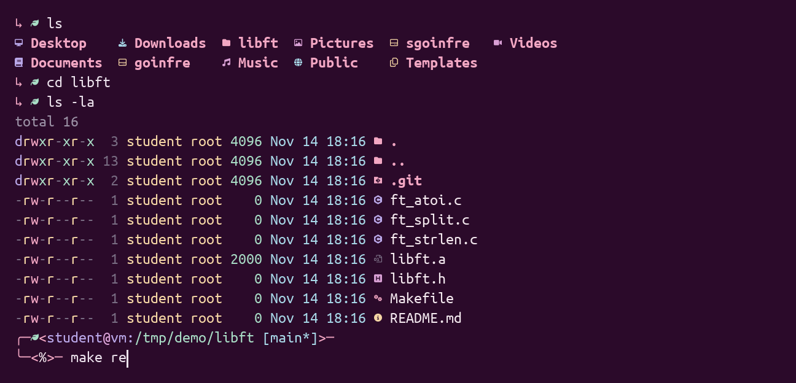

<div align="center">

# 🌿 Verdant Theme

**A clean and colorful Oh My Zsh theme.**


</div>

## ✨ About

Verdant is a custom Zsh theme for [Oh My Zsh](https://ohmyz.sh/), designed to give your terminal a clean look with colorful prompt elements.

### Features

- 🌸 **Sakura / mint color palette** for the prompt, Git branch and exit codes
- 🍃 **A little leaf at the start of the prompt**, before your user name (it turns pink when the last command failed)
- ↳ **Compact history**: once a command is sent, its big two-line header shrinks to a single `↳ 🍃 command` line, so your terminal stays clean
- 📁 **`ls` with icons**: every file and folder gets an icon matching its type (C, headers, Python, Makefile, images, archives, `.git`, `goinfre`…), in plain `ls`, `ls -a`, `ls -l`, `ls -la`, `ls -lah`

## 📸 Preview

Here's what Verdant looks like in a real terminal:



## ⚙️ Options

Add any of these to your `~/.zshrc`, **before** the line `source $ZSH/oh-my-zsh.sh`:

```bash
VERDANT_LEAF="🌿"               # use an emoji leaf instead of the Nerd Font one
VERDANT_ARROW="❯"               # change the arrow used for old commands
VERDANT_TRANSIENT_PROMPT=false  # keep the full header on every old command
VERDANT_LS_ICONS=false          # keep the normal ls
```

> `ls` options other than `-a`, `-A`, `-l`, `-h` and `-1` (for example `-t`, `-R`, `-S`) fall back to the normal `ls`. When the output is piped (`ls | grep …`), the normal `ls` is used too, so scripts are never affected.

## 🚀 Installation


### 0. Requirements

Before installing Verdant, make sure you have **Zsh** and **Oh My Zsh** installed on your system. If you haven't installed Oh My Zsh yet, you can install it using the official installation command:

```bash
sh -c "$(curl -fsSL https://raw.githubusercontent.com/ohmyzsh/ohmyzsh/master/tools/install.sh)"
```

Once Oh My Zsh is installed, you can proceed with the Verdant theme installation.

### 1. Clone the repository

```bash
git clone git@github.com:HorusExE69/verdant-theme.git
```

### 2. Copy the theme into Oh My Zsh

```bash
mkdir -p ~/.oh-my-zsh/custom/themes
cp verdant-theme/verdant.zsh-theme ~/.oh-my-zsh/custom/themes/
```

### 3. Enable Verdant

Open your `~/.zshrc` file and add:

```bash
ZSH_THEME="verdant"
```

### 4. Reload your shell

```bash
source ~/.zshrc
```

That's it! Verdant is ready to use. 🌱


### 5. Terminal Customization

Please note that Verdant only customizes your **Zsh prompt** (colors, symbols, Git information, etc.). It cannot change your terminal's background, cursor shape, cursor color, font, transparency or window appearance.

These settings depend on your terminal emulator and must be configured separately in its **Preferences / Appearance settings**. For the best experience, we recommend using a dark background, a compatible Nerd Font and a pink & mint-green color palette to match Verdant.

### 6. Install a Nerd Font (required for the icons)

The `ls` icons and the leaf are [Nerd Font](https://www.nerdfonts.com/) glyphs. Without one, you'll see empty squares. No `sudo` needed (works on 42 computers):

```bash
mkdir -p ~/.local/share/fonts
cd ~/.local/share/fonts
curl -fLO https://github.com/ryanoasis/nerd-fonts/releases/latest/download/JetBrainsMono.tar.xz
tar -xf JetBrainsMono.tar.xz && rm JetBrainsMono.tar.xz
fc-cache -f
```

Then pick **JetBrainsMono Nerd Font** in your terminal's preferences (GNOME Terminal: *Preferences → Profile → Custom font*). On macOS: `brew install --cask font-jetbrains-mono-nerd-font`.